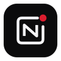

# NyxWatch

**macOS intrusion alerts and immediate locking — without recording.**

[Website](https://qyber-llc.github.io/nyxwatch/) · [Source](https://github.com/qyber-llc/nyxwatch)

## macOS 1.0.2

- Arm from the menu bar, floating button, Cmd + Esc, or optional Bluetooth proximity.
- Detect physical activity via system idle time, USB connections, volume mounts, lid closure and charger disconnection. No typed key content is read; USB device contents are not inspected.
- Both modes lock macOS immediately, independently of notification delivery. **Flag** adds a screen flash and spoken warning.
- Send text alerts (event type and timestamp) via configured WhatsApp, Telegram, iMessage or LAN endpoint. These messaging services use their own infrastructure.
- Optional local WhatsApp bridge retries failed text alerts.
- No keystroke collection, screen capture, camera, microphone, face analysis, app/window history or location collection. Legacy media retry queues are never loaded by this release.

The old corporate video and infographics describe an earlier version and are withdrawn from the current website. Other platform prototypes in `cross-platform/` are unchanged and are outside this macOS release.

## Install on Mac

[Download NyxWatch.dmg](https://github.com/qyber-llc/nyxwatch/releases/latest/download/NyxWatch.dmg)

Requires macOS 13 or later. The same app supports Apple Silicon and Intel.

1. Open the downloaded DMG.
2. Drag NyxWatch into Applications.
3. Open NyxWatch from Applications. Protection starts off.

The NyxWatch 1.0.2 installer is signed by QYBER LLC with Developer ID and notarized by Apple.

## Build from source (macOS)

```bash
./build.sh
open build/NyxWatch.app
```

- **Left-click** menu bar icon: Toggle surveillance On/Off.
- **Right-click** menu bar icon: Switch **Alert + Lock / Flag**, **FR / EN**, **Permissions Check**, **Calibrate 2m**, **Settings**, and **Link WhatsApp**.
- **Global Hotkey**: `⌘ + Esc` arms immediately from any app.

## Sign and notarize a release

Install `packaging/requirements.txt` in the Python environment used for packaging. A valid Developer ID Application identity must be installed with its private key, and notarization credentials must be stored in a local `notarytool` Keychain profile.

```bash
python3 packaging/build_dmg.py \
  --signing-identity "Developer ID Application: Your Name (TEAMID)" \
  --notary-profile "NyxWatch"
```

The packager enables Hardened Runtime, applies the Apple Events entitlement for configured text messaging, submits the app and DMG to Apple, staples their accepted tickets and validates Gatekeeper before replacing the output file. Submission reports and Apple logs are saved beside the DMG.

## Cross-Platform (`cross-platform/`)

See [`cross-platform/README.md`](cross-platform/README.md) for **Windows**, **Linux**, **Android**, and **iOS** builds.
